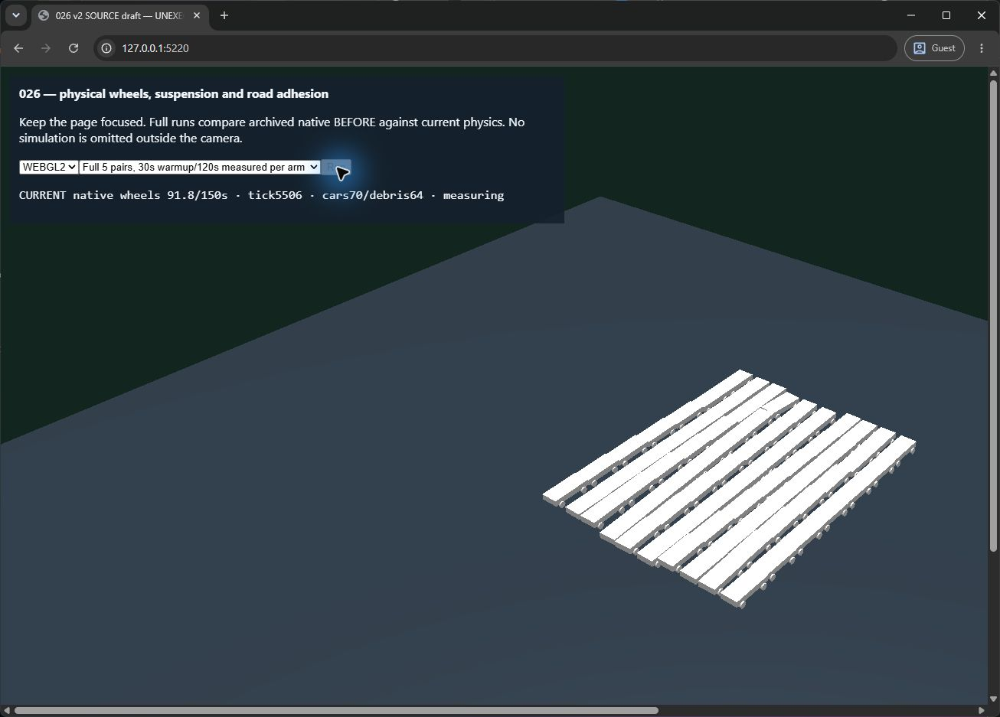

# PBI026 — verificare finală, 12 octombrie 2026

Implementarea integrată îndeplinește criteriile026 pentru fixture-ul timpuriu de roți/suspensie/aderență. [Cititorul strict comun](guest-both-full-20261012-r1.json) produce NUMERIC_PASS pe WebGPU și WebGL2 reale, iar [revizuirea parent](guest-parent-review-20261012-r1.json) confirmă condițiile fizice, calibrarea, focusul, instrumentarea și cleanup-ul. Mutarea în Done și validatorul sunt consemnate separat în task; acest raport numeric singur nu efectuează tranziția.

## Implementare și corectitudine

Catalog versionat dry/reduced; suspensie/contacte/steering/spin native readonly; diagnostic cinematic de alunecare; Babylon consumă fizica fără să o modifice. projectVisual omite datele nefolosite vizual. applyPhysicalWheels folosește scalari și scratch storage al rendererului fără pose-uri temporare sau istoric. Cleanup-ul construcției parțiale și normaldispose este verificat; recuperarea030 rămâne integrată.

Node24.21.0/npm11.19.0, Rapier0.21.0/Babylon9.29.0. [Check](visual-query-check-r1.txt):689/689 teste PASS, TypeScript/lint/format/arhitectură PASS. [Verificator nativ](visual-query-verifier-r1.txt) PASS. AFTER after-visual-query-20261011-r1:10lumi, checksum fizic/input implicit exact, cleanupzero; calibration-visual-query-20261011-r1:28scenarii originale PASS. Pins curente sunt în tests/browser/wheel-dynamics-v2/current-native-reference.mjs. Cinci perechi native laptop-visual-query-paired-20261011-r1:tickcurrentp954,409–4,939ms sub8ms; cost suplimentar projectionp950,305–0,521ms. Proba nativă măsoară project complet, nu numai query-ul vizual.

La20m/s, frânarea sedan este24,235m dry/28,889m reduced, compact21,582m/26,714m. Virajul dry8→20m/s crește viteza laterală la roată1,068→2,965m/s sedan și0,923→2,616m/s compact. Cele28scenarii verifică și bordură/airborne/recontact. Browserul reproduce opt calibrări/backend; cititorul validează curbele originale, nu doar rezultatele agregate.

## Condiții și capturi Full

Lenovo Yoga7 14ARP8/Ryzen7 7735U, Chrome154.0.8037.99, Windows26300/driver32.0.12019.1028, alimentator conectat; BatteryStatus2/80% după probe. Utilizatorul a deschis manual ChromeGuest. Parent a identificat fereastra32507982 și badge-ulGuest, un singur tab127.0.0.1:5220. DevTools închis, probe seriale, focus verificat prin observații UI și jurnale continue. Rezoluție internă/CSS1920×1080, DPR real păstrat. Materialele/fixture-ul și bugetele rămân neschimbate.

Source072448e3a600df086ff256163626cf60bab27bff37ed8d6f99c6b75d49a22921; artifactfa5f3bc43df8dc85ea38e000a79986474beccd520005507764c9a785b1aa699d. Preflight-urile [WebGPU](guest-webgpu-preflight-20261012-r1.json)/[WebGL2](guest-webgl2-preflight-20261012-r1.json) trec fiecare10brațe/export/hash/archive/cleanup. Full are5perechi alternante,30s warmup/120s măsurare perbraț,70vehicule/64debris/3obstacole,10brațe și8calibrări/backend.

| Backend și captură | Frame p95 current | Main p95 current | Tick p95 current | Projection p95 current | Confirmări frame/main/heap |
| --- | --- | --- | --- | --- | --- |
| WebGPU f88c49af-03eb-4839-a620-7d24adb589a5 | 16,8–16,9ms | 11,8–12,7ms | 5,0–5,3ms | 0,6ms | 0/0/1 |
| WebGL2 cc977c20-c79d-4b42-97f8-367e866b85e8 | 16,8ms | 10,1–10,6ms | 5,3–5,5ms | 0,6ms | 0/0/1 |

Zero LongTasks steady în toate20brațele, overloadzero, fără wheelhistory sau resurse native/Babylon rămase după cleanup. Regresia relativă rămâne >10% ȘI >1ms, respectiv >10% ȘI >5MiB, confirmată în3/5perechi. Raw/transport/terminal/source/artifact și producția nativă curentă sunt verificate independent. Comanda finală: `volta run --node 24.21.0 --npm 11.19.0 node scripts/verify-wheel-laptop.mjs f88c49af-03eb-4839-a620-7d24adb589a5 cc977c20-c79d-4b42-97f8-367e866b85e8 Docs/Evidence/026-laptop/guest-both-full-20261012-r1.json`, EXIT0.

Instrumentarea browser rămâne inclusă în bugetele observate, fără scăderea overhead-ului. Canalele au capacitate fixă1,2MB/braț, jurnal4096evenimente, cleanup fără overflow/late/pending. Revizuirea păstrează cele5perechi native observerOFF/ON cu checksumuri identice și wall deltas−0,420…+0,222ms/tick; variația nu este prezentată drept preț exact al observatorului browser sau al GPU-ului.

## Istoric și limite

[Starea anterioară](current-status-20261011-r2.md) păstrează FAIL52msWebGPU din profilul cu extensii și WebGL2PASS. Guest schimbă condiția investigată; nu reclasifică FAILurile și nu demonstrează cauzal că o extensie producea pauza. [Trace3ed8e0c1](performance-3ed8e0c1-summary.md) identifică Babylon buffers/primul renderWebGPU/primul stepRapier înainte de steady-state, fără reproducerea52/129ms. Toate capturile FAILED/INCOMPLETE și trace-urile originale rămân păstrate.

Limite: numai fixture timpuriu de calibrare/randare. Nu certifică jocul integrat, manualdriving final, presetulLOW final, timerGPU, inputlatency, coldnavigation controlat ori memoria totală/WASM exactă. O lume are material plat uniform; nu există model complet de anvelopă sau contact mixt pe patch-uri. Cauza task-urilor istorice52/129ms este nedemonstrată; profilul Chrome existent păstrează FAILul. Aceste limite nu anulează acceptarea noilor capturi complete în condițiileGuest documentate.

Tranziție finală: fișierul există numai în PBI/Done/026-wheel_dynamics.md. Validate-Board.ps1 -RequireDone '026' PASS,235PBI/50Done; Validate-Plan.ps1 PASS,1366linkuri. Loguri board-require-done-20261012-r2.json și plan-final-20261012-r1.txt. git diff --check PASS. PBI026 este Done pentru scope-ul timpuriu documentat.

